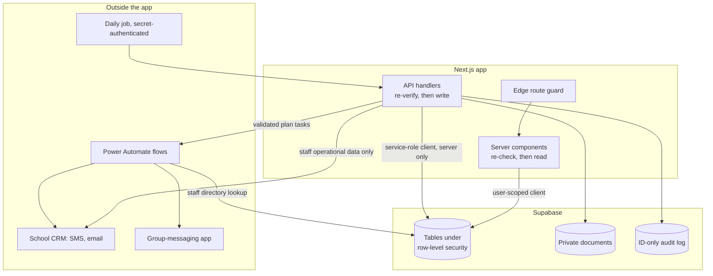

# Compliance Operations with Structural Access Control

Engineering notes from building an operations platform for **a regulated education provider**, a specialised school: a full-stack Next.js app with role-based access for staff across seven roles, credential compliance monitoring, CRM sync, scheduled jobs and a dual-library Excel import, plus a Microsoft Power Automate layer that detects staff absences from email, triages a mailbox with more than one model, and turns an annual strategic plan into recurring tasks.

The compliance logic was the easy part. **Under student-privacy and regulatory reporting obligations, any protection that depends on someone remembering a rule will eventually be forgotten, so the protections have to be properties of the structure:** which database client can reach which rows, which systems are never sent which data, and what a log line is physically able to contain.

Design notes and reasoning only. No client name, no source code, no credentials, no endpoints, no staff or student information, no compliance rule text.

**Deep dives:** [Access control and data handling by structure](docs/01-access-control-by-structure.md) · [The Power Automate layer](docs/02-power-automate-layer.md)

---

## Contents

1. [Problem shape](#1-problem-shape)
2. [Why convention fails here](#2-why-convention-fails-here)
3. [Architecture](#3-architecture)
4. [Access: three levels, one flag, three checks](#4-access-three-levels-one-flag-three-checks)
5. [Reads under policy, writes through one door](#5-reads-under-policy-writes-through-one-door)
6. [Data the platform is built not to hold](#6-data-the-platform-is-built-not-to-hold)
7. [Compliance monitoring](#7-compliance-monitoring)
8. [CRM sync that cannot block](#8-crm-sync-that-cannot-block)
9. [Spreadsheet intake with two libraries](#9-spreadsheet-intake-with-two-libraries)
10. [The automation layer](#10-the-automation-layer)
11. [Failure modes](#11-failure-modes)
12. [What I'd do differently](#12-what-id-do-differently)

---

## 1. Problem shape

Staff credentials (certifications, clearances, licences) each carry deadlines. Tracking them by hand, in calendar reminders, spreadsheets and email chains, holds the dates but does nothing with them: nothing escalates to a supervisor before a deadline, nothing records when a document was submitted or when anyone was reminded, and there is no self-service view for staff or aggregate view for administrators. The platform's job is to make that work run itself, so operational detail never needs senior leadership's attention.

| Need | Why it isn't trivial |
|---|---|
| Show each person their own compliance state | Without ever showing them anyone else's |
| Show supervisors and administrators everyone's | From the same tables, through the same app |
| Remind people before things expire | Once per run, not once per credential, never twice for the same window |
| Keep an audit trail | Without the trail becoming a new copy of personal data |
| Sync staff contacts to the school's CRM | Without a CRM outage blocking staff work |
| Import staff and plan tasks from spreadsheets | Written by people, with people's column headers |

Underneath all of it sit student-privacy and regulatory reporting obligations. That constraint shaped more decisions than any feature did.

---

## 2. Why convention fails here

The usual way a small internal tool handles sensitive data is a set of rules everyone knows: no names in logs, no querying other people's records from the browser, nothing sensitive to the CRM. Those rules hold while the codebase is small and its author is the only one touching it. They fail the first time someone adds a log line in a hurry or an integration grows a field, and they fail silently. Nothing errors when a log line includes a name.

**The test that sorts protections: could a well-meaning person violate it by accident, without changing the schema, the database client they are using, or an integration contract?** If yes, it is convention. Most of this write-up is about the protections that pass that test.

---

## 3. Architecture

The app (Next.js App Router on Vercel, Supabase for Postgres, auth and storage) is the system of record for staff operations. The Power Automate layer runs inside the school's Microsoft 365 tenant, and its absence flow resolves people from the same staff table rather than keeping its own mapping.

**Student records are not in the diagram because none of these components hold them.** They are not stored, duplicated or maintained anywhere in this platform; they stay in a separate system of record. That one boundary removes a whole class of risk from every component downstream.

---

## 4. Access: three levels, one flag, three checks

Staff span seven roles, but permissions are not modelled per role:

| Level | Rank | Reach |
|---|---|---|
| Basic | 0 | Their own compliance records; the compliance area is all they can open |
| Advanced | 1 | Everyone's compliance records, the dashboard, strategic planning |
| Admin | 2 | Everything, including staff management, credential types and settings |

The rank is numeric so a check reads "at least advanced" instead of a list of levels every check has to repeat correctly. On top sits **one capability flag** for managing scheduled team notifications, so a non-admin can run them without being handed full admin.

**Job function is a separate field from access level.** What someone does decides which credentials apply to them; their level decides what they can see. A new job title changes credential scoping and nothing about permissions.

Every privileged operation is checked three times, independently: the edge route guard redirects by level before render, the server page re-checks before fetching anything, and the API handler re-verifies on its own. The sidebar is also filtered by level, but **hiding a link is not access control**. A handler can be called without anyone visiting the page that normally calls it.

---

## 5. Reads under policy, writes through one door

Which database client a piece of code can import is the main structural control in the system:

| Client | Runs in | Row-level security | Used for |
|---|---|---|---|
| Cookie-bound server client | Middleware, server components | Enforced, as the signed-in user | User-facing reads |
| Browser client | Client components only | Enforced | Interactive components |
| Service-role client | Server only, holds no session | Bypassed | All writes |

**Reads are filtered by the database, not by the page.** Staff read only their own compliance records; advanced and admin users read all of them. The same query from two people returns different rows, so a page that forgets to filter still returns only what that person may see.

**Writes go through one door.** Writes do not rely on row policies: every mutation runs through the service-role client inside a handler that has already authorised the caller.

That door is kept narrow. One update, writing a CRM reference onto another staff member's record, had to cross the self-update restriction, so it goes through a single privileged database function that does exactly that and nothing else.

Full detail: [docs/01-access-control-by-structure.md](docs/01-access-control-by-structure.md)

---

## 6. Data the platform is built not to hold

| Boundary | Structural rule |
|---|---|
| Student records | Never stored here; they stay in the separate system of record |
| CRM and Power Automate | Staff operational data only; never student data |
| Audit log | IDs only. No names, no email addresses, no credential type names |
| Documents | Private bucket; retrieved only through a signed link that expires after 5 minutes |
| Storage paths | UUID filenames, so a path says nothing about whose document it is |

Every compliance write, server error and manual notification trigger writes an audit entry, referencing people and credential types by ID. **A credential type name next to a person reference is itself information about that person**, so even that is left out. Reading the log meaningfully means joining against tables already protected by policy, so the log inherits their protection instead of needing its own.

The repository's standing instructions also carry an incident protocol: if anything may have exposed protected student data, stop, alert leadership, log it. No silent recovery.

---

## 7. Compliance monitoring

### Status is computed, never read

| Expiry | Status |
|---|---|
| None (required once, at hire) | Current |
| Before today | Expired |
| Within 90 days | Expiring soon |
| Later | Current |

Every view recomputes status from the expiry date at render time and ignores the stored status column. A stored status is a cache with no invalidation: once midnight passes, every stored "current" that should now read "expiring soon" is wrong and nothing writes to the row to correct it. The column is still written for external queries, never trusted by the interface.

A credential type declares which job functions it applies to: everyone, one function, or a group by inclusion or exclusion. A boolean on the staff record marks someone who covers a role without holding the title, so they inherit its requirements. Credential types referenced by records can't be deleted (the foreign key restricts it), so they are deactivated and history can't be orphaned.

### The daily job

A Vercel cron job calls the notification route once a day. The route is let past the session guard and checks a bearer secret itself, returning 401 before any data access.

| Bucket | Window | Staff email and SMS | Supervisor email |
|---|---|---|---|
| 60-day | 31 to 60 days out | Yes | No |
| 30-day | 15 to 30 days out | Yes | Yes |
| Daily | 14 days or fewer, including expired; at most once a day | Yes | Yes |

**Buckets don't overlap. Messages are consolidated**, one email and one SMS per person per run however many credentials are due. **The job is idempotent**: per-bucket timestamps mean a re-run never double-sends. A manual admin trigger always bypasses the cooldown. The dashboard flags from 90 days, reminders start at 60, and supervisors are copied only in the final 30.

---

## 8. CRM sync that cannot block

Staff records always save to the database first. The sync runs after: find the contact by email, create or update it, apply the staff tag, write the contact reference back through the narrow function from section 5. If it fails, the record keeps a null reference, the roster shows a sync-status badge, and an admin re-syncs manually. Bulk import applies the same rule per row.

Each notification function checks its own configuration and, if something is missing, skips with a warning and returns an explicit "skipped" result instead of throwing. Partial configuration degrades the pipeline instead of crashing it.

---

## 9. Spreadsheet intake with two libraries

**Staff import** parses with ExcelJS and normalises more than 20 header variants. Duplicates are caught against existing emails and within the file in one pass, and the response lists imported rows and skipped rows, each with a reason.

**Strategic plans** go through a three-step wizard: a plan year spanning exactly one year, staff selection, then a task spreadsheet parsed twice:

| Pass | Library | Owns |
|---|---|---|
| Primary | ExcelJS | Column mapping, required fields, assignee lookup by email |
| Secondary | SheetJS | Raw date serials and embedded hyperlinks the primary parse doesn't surface |

Two parsers have to agree on what a row is, so one owns the structure and the other only contributes what the first can't see. Validated tasks go to Power Automate by webhook. **The app is the intake and validation layer; Power Automate is the execution layer**, so bad rows fail on a screen where a person can fix them, not halfway through a flow.

---

## 10. The automation layer

Three Power Automate flows share the tenant, an automation service account and their connections.

**Out-of-office detection** polls a shared mailbox every minute, one parallel run per email. GPT-4o classifies against more than 20 recognition patterns, an explicit definition of what is not an absence, and four absence types plus "none". It writes two messages: first name only and no reason for three group chats, full detail for the supervisor by SMS. Five systems take part, in about 60 seconds.

**Email triage** for one staff member's mailbox makes three model calls. GPT-4o picks a label (Action Required, Urgent, FYI, Review) and draft and task eligibility in one pass, checking recipient position first: CC-only can never be Action Required. GPT-5 writes a threaded reply draft that is never sent automatically, and a second GPT-5 call extracts tasks with a null due date when none is stated.

**Strategic tasks** convert Excel date serials and map weekly, biweekly, monthly and quarterly repeats onto To Do recurrence bounded by the plan year.

Full detail: [docs/02-power-automate-layer.md](docs/02-power-automate-layer.md)

---

## 11. Failure modes

| Failure | What it would look like | What prevents it |
|---|---|---|
| A page forgets to filter | Basic user sees colleagues' records | Row-level read policies |
| A handler is called directly | Privileged action without the page | Every handler re-verifies |
| Service-role client reaches the browser | Every read policy bypassed | Server-only module, never imported client-side |
| Stale stored status | Dashboard counts drift | Status recomputed on every render |
| Job re-run or retried | Duplicate reminders | Per-bucket timestamps; daily cooldown |
| Unauthenticated call to the job | Reminders triggered by anyone | Bearer secret first; 401 before data access |
| CRM outage | Staff saves blocked | Save first, sync second; null reference and re-sync |
| Audit log as a leak | Personal detail in a long-retained table | IDs only |
| Forwarded document link | Lasting access to a private file | 5-minute signed links |
| Model wraps JSON in code fences | Parse failure mid-flow | Fences stripped before parsing |
| CC-only email triaged as urgent | Draft for someone who wasn't asked | Recipient position decided first |

Most of these mitigations are things a well-meaning person would have to change on purpose to break, not things they have to remember to keep doing.

---

## 12. What I'd do differently

Both changes are about keeping logic in one place.

**Keep one status function, not copies.** I'd put the live-status derivation in one shared module from the first file that needs it, rather than repeating it in each file that handles compliance data. Copies that start identical stay identical only until the next edit, and two views disagreeing about whether a credential has expired is exactly what the derivation exists to prevent.

**Move mappings out of code.** The strategic task flow maps five categories to owners with nested conditionals. The absence flow already shows the better pattern: resolve from data at runtime.

---

## Stack

Next.js App Router · React · Supabase (Postgres, Auth, Storage, row-level security) · Tailwind CSS · Vercel cron · ExcelJS · SheetJS · Microsoft Power Automate · Microsoft Graph (Outlook, To Do) · GPT-4o and GPT-5 · CRM integration for SMS and email · group-messaging bots

---

*Engineering notes only, published with the client's permission. Contains no source code, credentials, API keys, endpoints, staff or student information, message content, compliance rule text, regulation specifics, or client-identifying information.*
